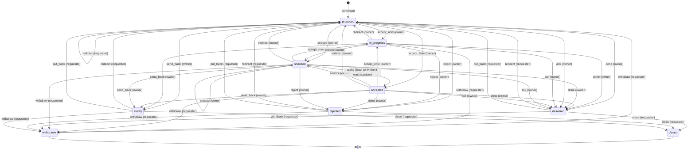

# Ask state machine

Generated from `RULES` in `src/domain/transitions.ts` by `npm run diagram`. Do not edit by hand.

Owner's plate: proposed, in_progress, accepted, snoozed. Requester's plate: delivered, rejected, clarify. Ended: closed, withdrawn.

| Action | Who, from which states | Lands in |
|---|---|---|
| `accept_now` | owner: proposed, accepted, snoozed | in_progress |
| `accept_later` | owner: proposed | accepted |
| `done` | owner: proposed, in_progress, accepted, snoozed | delivered |
| `ack` | owner: proposed, in_progress, accepted, snoozed | delivered |
| `reject` | owner: proposed, in_progress, accepted, snoozed | rejected |
| `send_back` | owner: proposed, in_progress, accepted, snoozed | clarify |
| `set_deadline` | owner: accepted, in_progress, snoozed | (same state) |
| `snooze` | owner: proposed, in_progress, accepted, snoozed | snoozed |
| `set_estimate` | owner: proposed, in_progress, accepted, snoozed | (same state) |
| `redirect` | owner: proposed, in_progress, accepted, snoozed requester: delivered, rejected, clarify, proposed | proposed |
| `close` | requester: delivered, rejected, clarify | closed |
| `put_back` | requester: delivered, rejected, clarify | proposed |
| `withdraw` | requester: proposed, in_progress, accepted, snoozed, delivered, rejected, clarify | withdrawn |
| `wake` | system: snoozed | state before the snooze |
